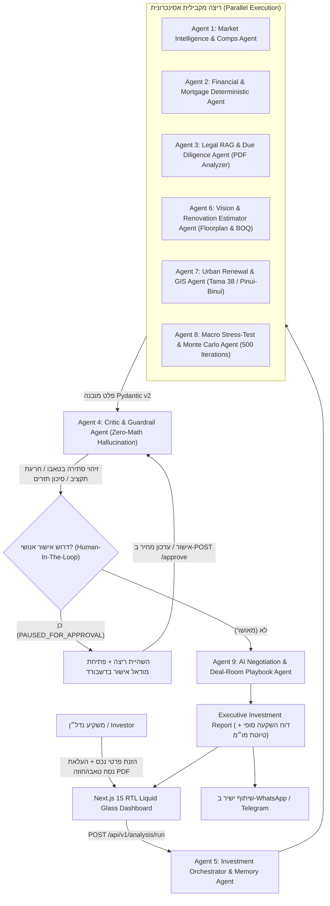

# 🏢 PropTech Multi-Agent Real Estate Investment Analyzer (v2.0)

[](https://github.com/IDAN2468D/proptech-multi-agent/actions/workflows/ci.yml)
[](https://fastapi.tiangolo.com)
[](https://nextjs.org)
[](https://python.org)
[](https://docker.com)
[](https://modelcontextprotocol.io)
[](https://opensource.org/licenses/MIT)

> **מערכת מרובת-סוכנים אוטונומית מהפכנית לניתוח השקעות נדל״ן (v2.0 Expansion Pack)**
> המשלבת 9 סוכני AI מתמחים, רשת שרתי FastMCP, תחקור RAG משפטי נגד הרעלת תוכן, חישובים פיננסיים דטרמיניסטיים (Zero-Math Hallucination), ראייה ממוחשבת לשיפוצים, הדמיות מונטה-קרלו, ודשבורד Next.js 15 RTL יוקרתי עם סאונד מרחבי (Spatial Audio Feedback).

---

## 🌟 ארכיטקטורת 9 הסוכנים האוטונומיים



---

## 🤖 פירוט 9 הסוכנים המתמחים

| סוכן | שם ותפקיד | תיאור טכנולוגי ויכולות |
| :--- | :--- | :--- |
| **Agent 1** | **Market Intelligence & Comps** | איסוף עסקאות השוואה מנדל"ן ממשלתי, חישוב מחיר חציוני למ"ר, וקביעת מדד נזילות שכונתי. |
| **Agent 2** | **Financial & Mortgage Agent** | חישוב דטרמיניסטי בפייתון (נוסחת שפיצר/קרן שווה), מדרגות מס רכישה ישראלי, IRR 10 שנים ו-Cash-on-Cash. |
| **Agent 3** | **Legal RAG & Due Diligence** | חילוץ טקסט מ-PDF (טאבו/חוזה), אינדוקס וקטורי עם סניטציה מפני הרעלת תוכן (`Context Poisoning`), וציטוט מדויק של הערות אזהרה, חריגות ומשכנתאות. |
| **Agent 4** | **Critic & Guardrail Agent** | בקר אימות מתמטי דטרמיניסטי, זיהוי סתירות שטח בין מודעה לטאבו (`Context Clash`), והפעלת בלימת HITL. |
| **Agent 5** | **Investment Orchestrator** | מנהל הריצה המקבילית, שילוב זיכרון ארוך-טווח של המשקיע (MongoDB Memory), ושמירת מצב ב-PostgreSQL. |
| **Agent 6** | **Vision & Renovation (v2.0)** | ניתוח תמונות ותשריטי דירה, זיהוי פוטנציאל פיצול/הוספת חדר, והפקת כתב כמויות (`BOQ`) דטרמיניסטי לשיפוץ. |
| **Agent 7** | **Urban Renewal GIS (v2.0)** | ניתוח גיאו-מרחבי (GIS) להסתברות תמ״א 38 / פינוי-בינוי, מרחק לתחנת רכבת קלה/מטרו ואפסייד השבחה. |
| **Agent 8** | **Macro Stress-Test (v2.0)** | מנוע סימולציית מונטה-קרלו (500 איטרציות) לבחינת עמידות העסקה בעליית ריבית בנק ישראל ושיעורי אי-תפוסה (`P10`, `P50`, `P90`). |
| **Agent 9** | **Negotiation Playbook (v2.0)** | אסטרטגיית מו״מ מבוססת ליקויים, הצעת מחיר נגדית אופטימלית, טיוטת הודעה לעו״ד/מתווך ושיתוף ל-WhatsApp/Telegram. |

---

## 🛠️ רשת שרתי ה-FastMCP (Model Context Protocol)

המערכת מצוידת ב-5 שרתי MCP ייעודיים בתיקיית `mcp_servers/`:
1. `proptech_mcp_server.py`: שרת כלי החישוב הפיננסיים, עסקאות השוואה ודוחות השקעה.
2. `geospatial_gis_mcp.py`: שרת GIS לתחקור תב״ע, תמ״א 38 ומרחק לרק״ל.
3. `playwright_market_mcp.py`: שרת אוטומציית דפדפן לניטור מודעות מתחרות וזמן מדף (DOM).
4. `boi_macro_rates_mcp.py`: שרת נתוני מאקרו, ריבית בנק ישראל, ריבית פריים ומדד תשומות הבנייה.
5. `deal_room_comms_mcp.py`: שרת תקשורת ושיתוף עסקאות מול מתווכים ומשקיעים.

---

## ⚡ הפעלה מהירה באמצעות Docker (הכול בקליק אחד)

המערכת כולה מוגדרת ורצה בצורה מלאה ומתואמת ב-Docker Compose:

```bash
# שכפול הריפוזיטורי
git clone https://github.com/IDAN2468D/proptech-multi-agent.git
cd proptech-multi-agent

# העתקת משתני סביבה
cp .env.example .env

# הרמת כל שירותי המערכת (PostgreSQL, MongoDB, Backend, Frontend)
docker compose up -d --build
```

### 🌐 כתובות השירותים הזמינים:
* **🖥️ Frontend UI (Next.js 15):** [http://localhost:3000](http://localhost:3000)
* **📚 Backend API Docs (Swagger):** [http://localhost:8000/docs](http://localhost:8000/docs)
* **🐘 PostgreSQL 16 (Relational DB):** `localhost:5435`
* **🍃 MongoDB 7 (RAG & Memory):** `localhost:27017`

---

## 🧪 הרצת בדיקות מקיפות (Unit, Integration & Evals)

### הרצת בדיקות Backend בתוך Docker:
```bash
docker exec proptech_backend pytest tests/unit tests/integration tests/evals -v
```
*(תוצאה: 17 בדיקות עוברות בהצלחה מלאה, כולל הערכת סוכנים ובלימת הזיות).*

### בדיקת טיפוסים ובנייה של ה-Frontend:
```bash
cd frontend
npm run typecheck
npm run build
```

---

## 📬 קובץ Postman מוכן לשימוש

קובץ האוסף המלא והמעודכן נמצא בנתיב:
`PropTech_Multi_Agent.postman_collection.json`

כולל:
1. אימות ו-JWT (`POST /register`, `POST /login`).
2. זיכרון משקיע (`GET/PUT /investor/profile`).
3. יצירת נכס והעלאת PDF ל-RAG (`POST /properties`, `POST /properties/:id/documents`).
4. הרצת 9 הסוכנים ואישור HITL (`POST /analysis/run`, `POST /analysis/:id/approve`, `GET /analysis/:id`).
5. נתיבי v2.0 (`Vision Upload`, `Monte Carlo Stress-Test`, `Share Deal to WhatsApp`).

---

## 🏗️ מבנה הפרויקט (Repository Structure)

```text
proptech-multi-agent/
├── .github/workflows/ci.yml         # GitHub Actions Full-Stack CI Pipeline
├── app/
│   ├── bll/
│   │   ├── agents/                  # 9 Autonomous Agents + Critic + Orchestrator
│   │   ├── rag/                     # Loader, Splitter, Embedder & Sanitized Retriever
│   │   └── tools/                   # Financial Math, Renovation & Stress Engines
│   ├── controllers/                 # FastAPI REST Endpoints
│   ├── dal/                         # SQLAlchemy (Postgres) & Motor (MongoDB) Repositories
│   └── models/                      # Pydantic v2 & SQLAlchemy Data Models
├── frontend/                        # Next.js 15 App Router (TypeScript, Tailwind, Lucide)
│   ├── src/app/                     # Pages & Layouts (RTL Native)
│   ├── src/components/              # Visualizer, HITL Modal, Vision, GIS, Sandbox, Audio
│   └── src/lib/                     # API Client, Zod Schemas & Formatters
├── mcp_servers/                     # 5 FastMCP Server Implementations
├── specs/                           # SDD Documentation (PRD, SPEC, PLAN, AGENTS)
├── tests/                           # Unit, Integration & Agent Evaluation Tests
├── docker-compose.yml               # Production & Dev Multi-Container Topology
├── Dockerfile                       # Multi-stage Backend Container
├── PropTech_Multi_Agent.postman_collection.json # Complete API Collection
└── README.md                        # Documentation & User Guide
```

---

## 🔒 אבטחה, אמינות ו-Zero-Math Hallucination

1. **אפס הזיות מתמטיות:** מודלי ה-LLM מנועים מלבצע אריתמטיקה ישירה – כל לוח סילוקין, מדרגת מס רכישה, חישוב שיפוץ וסימולציית מונטה-קרלו מתבצעים באמצעות מנועי Python דטרמיניסטיים בלבד.
2. **הגנת Context Poisoning:** כל מסמך PDF (נסח טאבו, שמאות, חוזה) עובר חיטוי רגולרי להסרת הנחיות נסתרות (System Prompt Injections).
3. **מעצור אנושי (HITL):** זיהוי אי-התאמה בין שטח הדירה בפרסום לשטח בטאבו או חריגת תקציב משעה את התהליך ומחייבת אישור מפורש של המשקיע.

---

## 📄 רישיון
פרויקט זה מופץ תחת רישיון MIT. לפרטים נוספים ראו קובץ LICENSE.
